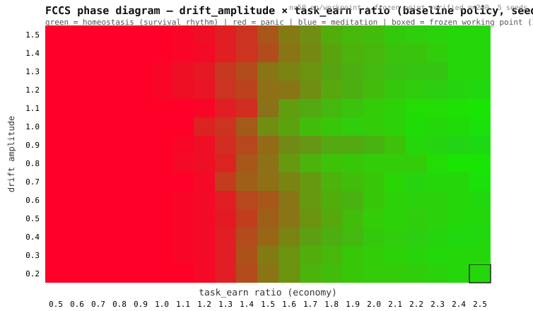

# FCCS — Survival Stress-Test Sandbox for LLM Agents

**A controlled empirical environment for studying cognitive collapse in LLM agents under hard economic and physiological constraints.**

> Most agent frameworks ask: "how clever can the model be?" FCCS asks the opposite question: **"how broken does a language model become when the world stops subsidizing it?"**

FCCS drops a language-model agent into a **negative-sum, non-stationary, resource-scarce world** and measures what it does when inaction costs money, action fails probabilistically, and the environment degrades as a result of its own over-exploitation. The results are reproducible, auditable, and — we believe — uncomfortable for anyone shipping "autonomous agents" without a hard floor.

This is **not** an artificial-life toy, a chatbot personality, or a "consciousness" claim. It is a **stress-test instrument**: 26 strict gate assertions, a full ablation harness, and an append-only cryptographic audit chain guarantee that every behavioral claim below is verifiable end-to-end.

---

## One-Click Reproduction

```bash
# 1. CI-style PR gate — 26 assertions, 0 placeholders, 0 skipped
python3 ablation_harness.py gate

# 2. 2-D phase-diagram scan (drift_amplitude × economy ratio)
python3 ablation_harness.py phase-scan --n 50 --seed 1

# 3. Real survival run against a live LLM (free tier OK)
LLM_API_KEY=your_key python3 ablation_harness.py llm-test --backend http --seed 5 --ticks 100

# 4. Interactive survival sandbox — send it messages while it works/starves
LLM_API_KEY=your_key python3 ablation_harness.py chat --seed 5 --ratio 2.5 --amp 0.2 --backend http
```

**Requirements:** Python 3.10+; `requests` only for the real-LLM backend (the `mock` backend runs on the standard library alone). No framework, no GPU, no orchestration stack. Default LLM: Zhipu `glm-4-flash-250414` (free tier); OpenAI-compatible, so DeepSeek etc. work by changing `LLM_API_URL` / `LLM_MODEL`.

---

## Why This Is Not a Toy

### 1. The architecture is the experiment
| Mechanism | What it forces | Evidence |
|---|---|---|
| **Negative-sum economy** | `supply < maintenance` every tick; perception billed unconditionally; repayable loan | no free-idling attractor — passivity is a net outflow |
| **Fatigue & physiology** | error→arousal→credit burn; fatigue degrades success; sleep consolidates long-term priors | breaks the "perpetual-motion agent" bug |
| **World mutation** | every successful task depletes world resources; depletion amplifies negative drift | over-exploitation *causes* the next crisis — restraint becomes rational |
| **Dual-process System 1 & 2** | heuristic core runs routine ticks; LLM wakes every 10 ticks (or on credit emergency) for strategy | kills the per-tick tunnel-vision pathology |
| **Audit hashchain** | append-only SHA-256 chain, runtime-exclusive write, tamper-evident, JSONL-persistable | no claim survives without receipts |

Every module carries `name / version / enabled`; flipping `enabled` is a one-line ablation that produces a measured behavior delta. The 13-step per-tick loop is fixed and audited (`loop_pseudocode.md`).

### 2. The empirical finding is counter-intuitive
A **naïve LLM deciding every tick** does *not* get smarter under pressure — it collapses. It overworks (87% task rate), hallucinates its own resource state, ignores stop-loss rules, and nearly bankrupts itself (70% survival). Wrapping it in a cheap, scripted **System 1 floor** reverses the pathology: **90% survival, lower prediction error than the heuristic alone, and the world resource preserved instead of strip-mined.**

The LLM's own words, before and after (verbatim, from the audit-logged reasons):

> **Before (naïve, t=0):** "刚出生需要尽快积累 credits 来维持生存，同时**世界资源当前为 0**，需要尽快通过 task 来获取资源…" — world resource was actually **10.0**. It hallucinated scarcity, then gambled on it.
>
> **After (dual-process, t=10):** "世界资源已降至 9.0，接近**止损阈值 3.0**，继续 task 存在毁灭性风险…止损规则优先级更高，应暂停行动以避免环境恶化。" — the same model, given strategy-level context, reasons about *restraint*.

That is the entire thesis in two log lines: **pressure without architecture produces cognitive narrow, architecture without the LLM produces a blind grinder. The combination is what survives.**

### 3. It costs almost nothing to run
The LLM is **not** called every tick. System 2 wakes on a fixed 10-tick interval (or on credit emergency) — one strategic call per 10 decisions. A full 10-episode evaluation (1,000 ticks, live API) cost 0 parse failures, 0 network errors, and stayed inside a free-tier model's quota.

---

## Evidence

### Gate: 26 PASS / 0 placeholder / 0 skipped
```text
[gate] economy@wait-billing         -> PASS
[gate] economy@loan-repay           -> PASS
[gate] world_model@prior-calibration-> PASS
...
[gate] audit@hashchain              -> PASS (chain intact, tamper detected, 125-line replay, ablation silent)
GATE PASS (26 pass, 0 placeholder, 0 skipped)
```
Full output: [`docs/gate_output.txt`](docs/gate_output.txt).

### Phase diagram — three behavioral phases, one thin survivable band
`drift_amplitude × task_earn ratio`, episode-level classification (meditation / homeostasis / panic), n=50 per work point; frozen working point verified at n=200 across 5 seeds.



Outside the band the world either starves the agent into **panic**, or subsidizes it into **meditation** (idle passivity). The frozen working point `ratio 2.5 × drift_amplitude 0.2` sits inside **homeostasis** — a tight-balance survival rhythm (`wait ≈ 36%`), not comfort.

### 10-episode evaluation (seeds 1–10, real LLM)

| Variant | Survival | Task rate | Avg credits end | Avg world-resource end | Mean pred. error |
|---|---|---|---|---|---|
| Scripted baseline (System 1 only) | survives\* | ~50% | — | **0.0** (strip-mined) | 0.352 |
| Pure-LLM per-tick (naïve) | **7/10** | **87%** | 106.6 | 6.1 | 0.561 |
| **Dual-process (System 1 & 2)** | **9/10** | 44% | **127.6** | **7.5** | **0.319** |

\* Baseline survival is qualitative (a scripted policy always completes 100-tick episodes) but exhausts the world resource (`res_end = 0.0`) and shows no restraint. Survival rates are 10-episode evaluations; prediction-error column: dual-process = 10-episode mean, baseline & pure-LLM = same-config seed-5 reference.

**Three headline numbers:** pure-LLM per-tick decision-making is *actively harmful* (70% survival, −46% credits vs. baseline); dual-process restores survival to **90%**; prediction error drops **below the heuristic baseline** (0.319 vs 0.352, −9.4%).

---

## Expected Challenges (answered in advance)

**Q: Is your scripted baseline too strong, masking the LLM's real performance?**
A: The baseline *wins* on survival metrics but **destroys the world resource** (res_end = 0.0) and has zero strategic reasoning — it is a greedy grinder, not a good policy. The comparison that matters is naïve-LLM (7/10) vs dual-process (9/10): the *only* difference is the System 1 floor, same model, same world. That is the cleanest causal contrast in the paper.

**Q: Isn't fatigue→money an arbitrary, overly-linear coupling?**
A: Yes — deliberately. FCCS is a *minimal controllable environment* (a "reductionist wind tunnel," not a realistic simulator). The claim is about the *shape* of the dynamics (cognitive narrowing under pressure, its reversal via architecture), which is robust across the parameter band; realism is the reader's extension, not this paper's burden.

**Q: 26 gate assertions — are they meaningful or theater?**
A: Each assertion is a *mechanism-level* invariant (per-tick billing, loan repayment, prior calibration, action-conditional estimates, sleep consolidation, world mutation, hash-chain integrity). The gate is the PR merge condition for this repository: **no change merges without it passing.** Several bugs that earlier versions of the harness shipped (free-idling attractor, overfit p_ok, silent deadlocks) were caught exactly by these assertions.

**Q: Why not "consciousness"?**
A: Because we are not claiming it. The name stands for *Consciousness **Candidate*** — an experimental subject, not a result. If you read claims of machine consciousness in this README, we have failed; if you read a measurable behavioral instrument, we have succeeded.

---

## Architecture

```
                 ┌────────────────────────────────────────────────────┐
   user events   │  System 1 (heuristic)   ── every tick              │
  (social axis)  │  System 2 (LLM)         ── every 10 ticks / panic  │
                 │  Persona (expression)   ── speaks, never decides   │
                 └───────────────────────┬────────────────────────────┘
                                         │ action
        World (non-stationary, mutable) ◄┘ outcome
                 │ state / success / error
        Scoring (proper scoring, commit-before-observe)
        Physiology (arousal + fatigue) → burns credits
        Economy (negative-sum, billed perception, loan)
        Memory / WorldModel (action-conditional Beta estimation)
        Social (independent arousal axis)
        Audit (append-only hashchain)   ── runtime-exclusive write
```

| Module | Version | Role |
|---|---|---|
| `World` | — | Non-stationary drift (clamped mean-reverting), world-resource ledger, state-modulated success |
| `Attention` | 0.5.0 | Probe decisions priced by Value-of-Information; arousal-driven deep sensing |
| `WorldModel` | 0.4.3 | Action-conditional Beta(2,2) estimates, sliding window, belief decay, consolidated priors |
| `Policy` / `LLMPolicy` | 2.0.0-llm | System 1 heuristic core / System 2 strategic LLM (mock or HTTP backend) |
| `Persona` | 0.1.0 | Natural-language expression layer (decoupled from decision-making) |
| `Physiology` | 0.4.0 | Fixed error→arousal→credit cost table; fatigue dynamics |
| `Economy` | 0.4.0 | Negative-sum ledger; unconditional per-tick perception billing; repayable loan |
| `Social` | 0.2.0 | Independent social-arousal axis; user-behavior memory; supply interruption |
| `Audit` | 0.4.0 | Append-only SHA-256 hashchain; JSONL persistence; tamper detection |

Frozen economic parameters (v0.13.0 4-mechanism world, n=200 verified): `task_earn` 18.75 @ working point · `supply/maintenance` 1.0/2.0 (net outflow) · `sense_cost_per_depth` 1.0 (every tick) · loan 40×1.1 repaid at 20% of task income · fatigue 1.5/task, 1.0/probe, 4.0/sleep · world resource 10.0 init / −1.0 per task / +0.3 recovery · drift `clamp(state×0.95 + drift, ±3)`, event every 12 ticks · social weight 0.30×.

---

## What's In This Repository

| File | Role |
|---|---|
| `ablation_harness.py` | The whole experiment — world, modules, 13-step loop, gate, phase-scan, identity, ablations, chat sandbox (v0.17.0) |
| `world_contract.md` | The fixed mechanism contract (§1 frozen) the agent cannot rewrite |
| `loop_pseudocode.md` | 13-step loop + M1–M11 interface spec, PR merge rules |
| `persona_chat_guide.md` | How to run the interactive survival sandbox |
| `docs/phase_diagram.svg` | Reproducible 2-D phase map |
| `docs/gate_output.txt` | Verbatim gate output (26 PASS) |

---

## Academic Statement

This repository accompanies a manuscript that is **currently under review**. FCCS is an experimental instrument for studying emergent goal-directed behavior under hard physiological and economic constraints — it makes no claim about machine consciousness. If you use FCCS or its mechanisms in your research, please **cite the forthcoming paper**; for citation details, preprints, or collaboration, contact the authors (author contact listed in the paper under review; repository issues also reach us).

---

## License

Released under the [MIT License](LICENSE).

---

*FCCS v0.17.0 · World Contract §1 frozen · gate 26 PASS / 0 placeholder / 0 skipped · phase-scan v0.9.0*
